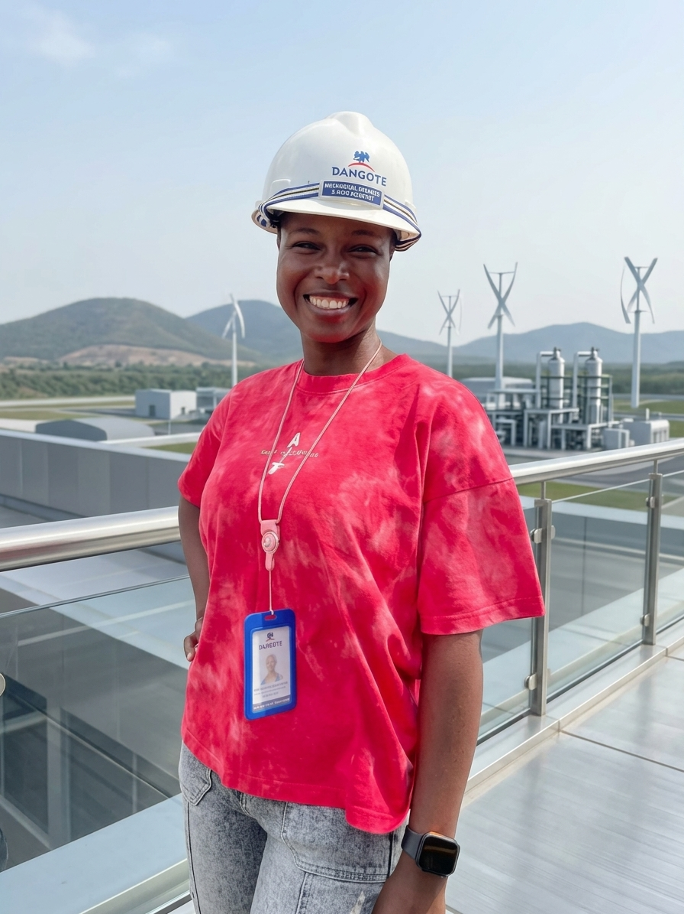

<!-- ========== HEADER BANNER ========== -->
<div align="center">


<a href="https://git.io/typing-svg">
  
</a>

<br/>


</div>

---

## 👩🏽‍🔧 About Me

> *I'm a mechanical engineer who looked at the mountains of data coming off industrial equipment and thought: "There's a story in here."*

Years of **hands-on maintenance, troubleshooting and planning** taught me how machines behave. Data science taught me how to *listen* to them. Today I combine both to:

| 🎯 Mission | 💡 What it means |
| :--- | :--- |
| **Predict, don't react** | Spot equipment degradation early and cut unplanned downtime |
| **Protect the planet** | Apply data science to air and water pollution challenges |
| **Tell the story** | Turn complex data into clear, actionable engineering decisions |

---

## 🧰 Toolkit

<div align="center">

| 🔧 Domain | ⚡ Tools & Skills |
| :---: | :--- |
| 📊 **Analytics & Visualization** |      |
| 🤖 **Data Science** |   |
| ⚙️ **Engineering** |    |
| 🗣️ **Soft Skills** |    |

</div>

---

## 🚀 Featured Projects

> 🚧 *Add your projects below. Copy a row, swap in your details, and you're done.*

| 📁 Project | 📝 What it does | 🛠️ Tech | 🔗 Links |
| :--- | :--- | :--- | :---: |
| **Project Name 1** | One-line summary of the problem you solved and the result | `Python` `Pandas` | [Code](#) · [Demo](#) |
| **Project Name 2** | One-line summary of the problem you solved and the result | `SQL` `Power BI` | [Code](#) · [Demo](#) |
| **Project Name 3** | One-line summary of the problem you solved and the result | `Python` `scikit-learn` | [Code](#) · [Demo](#) |

<details>
<summary><b>🔍 Project ideas that match my interests (click to expand)</b></summary>
<br/>

- ⚙️ **Predictive maintenance model** for pumps, motors or compressors using sensor data
- 📉 **Equipment downtime dashboard** in Power BI (MTBF, MTTR, availability)
- 🌫️ **Air quality analysis** of a Nigerian city using open pollution datasets
- 💧 **Water quality classifier** predicting safe vs. unsafe samples

</details>

---

## 🌱 Where I'm Heading

```text
🔭 Currently learning   →  Machine learning & predictive modelling
🛠️ Currently building   →  Condition-based maintenance analytics
🌍 Next big goal        →  Environmental data science for cleaner air & water
💬 Ask me about         →  Maintenance planning, asset reliability, Power BI, SQL
```

| ⚙️ Predictive & Condition-Based Maintenance | 🌍 Environmental Data Science | 📈 Operational Efficiency |
| :---: | :---: | :---: |
| Fix it *before* it breaks | Air & water quality monitoring | Smarter asset strategy |

---

## 🎨 Beyond the Spreadsheet

<div align="center">

🧪 **Olfactory Art & Fragrance Chemistry** &nbsp;•&nbsp; 🎨 **Art Therapy**

*Pattern recognition isn't only for data. It's also for scent notes and colour palettes.*

</div>

---

## 📈 GitHub Stats

<div align="center">

<!-- Replace YOUR_USERNAME with your GitHub username -->


</div>

---

## 🤝 Let's Connect

<div align="center">

[](https://linkedin.com/in/YOUR_LINKEDIN)
[](mailto:YOUR_EMAIL@example.com)
[](https://YOUR_WEBSITE)

<br/>

<i>"Transforming raw operational data into actionable insights for cleaner, more reliable industrial operations."</i>


</div>

